# Klaira — Deteksi Dini Overclaim pada Iklan Skincare

> **Cek klaim, belanja lebih bijak.**
> Prototipe *front end* Flutter untuk proyek **“Aplikasi Deteksi Dini Overclaim pada Iklan Skincare untuk Mendukung Konsumsi yang Bertanggung Jawab (SDG 12)”** — mata kuliah *Project Mobile Front End*, S-1 Teknik Informatika, Universitas Mikroskil.

| Anggota | NIM |
|---|---|
| Arza Fawazi | 241112326 |
| Vincent Roderick | 241111684 |
| Figo Kosasih | 241111993 |
| Jason Kho | 241110782 |

Aplikasi ini adalah antarmuka depan dari model **neurofuzzy (ANFIS)** yang dikembangkan pada penelitian NLP kelompok. Pada proyek ini **semua data adalah dummy** dan proses analisis **disimulasikan secara lokal** dengan struktur keluaran yang sama persis dengan kontrak data model. Tidak ada backend, login, atau server.

---

## 📱 Tangkapan layar

| Splash | Onboarding | Beranda | Cek Iklan | Menganalisis |
|---|---|---|---|---|
| 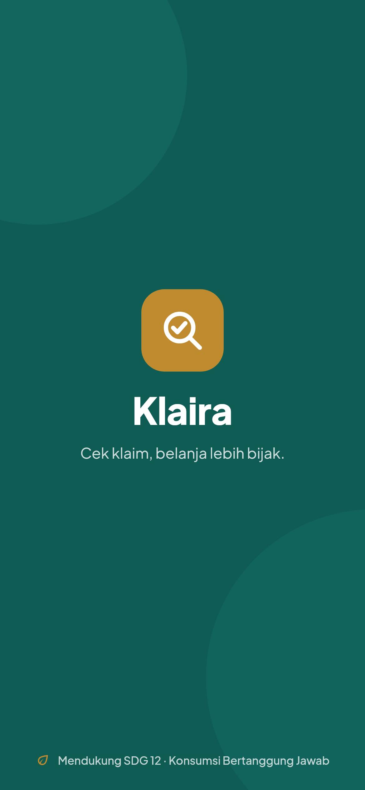 | 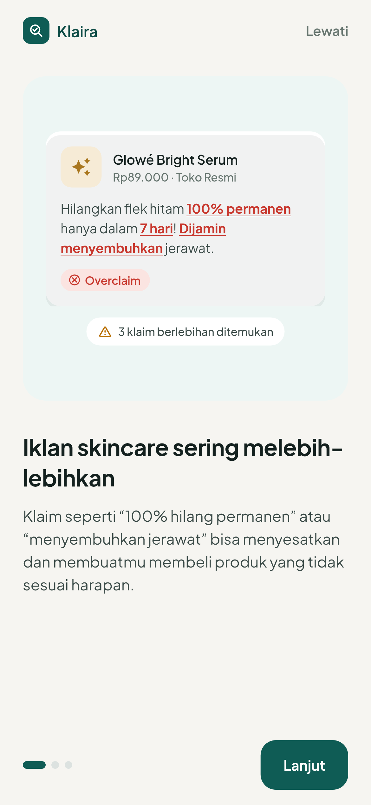 | 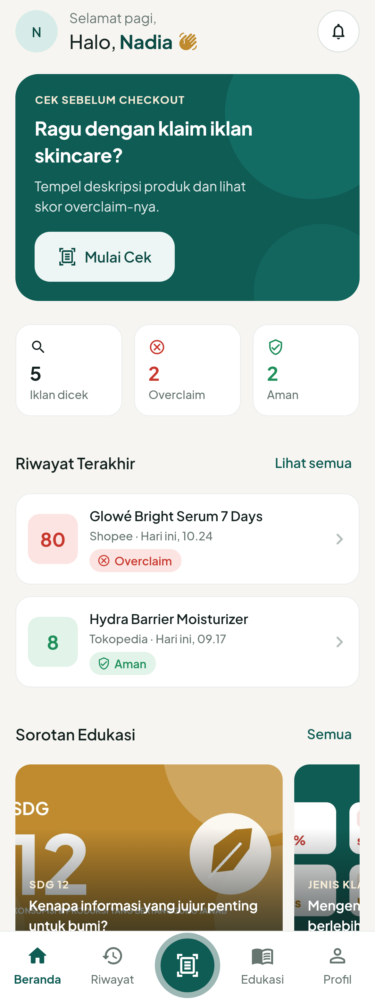 | 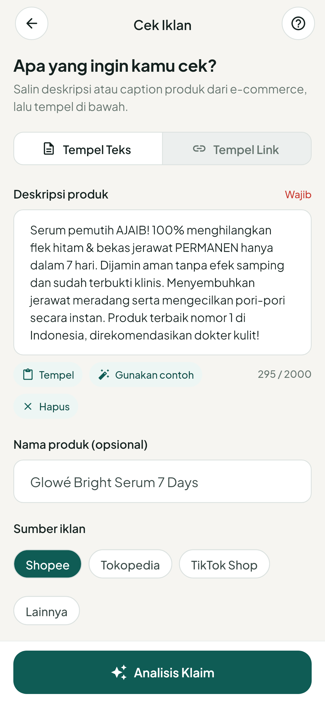 | 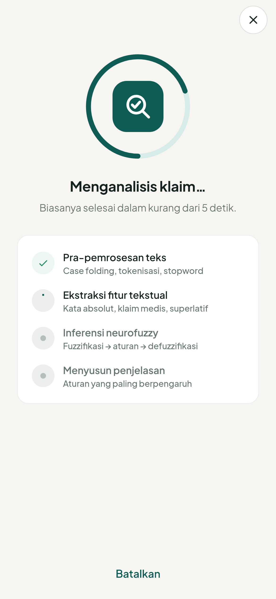 |

| Hasil Analisis | Detail Klaim | Riwayat | Edukasi | Profil |
|---|---|---|---|---|
| 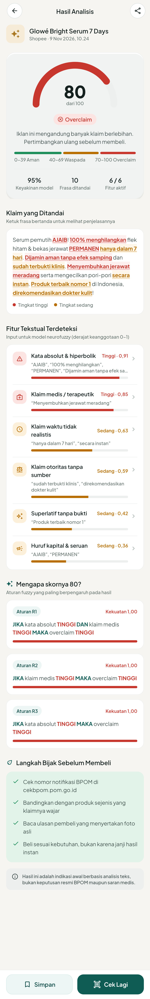 | 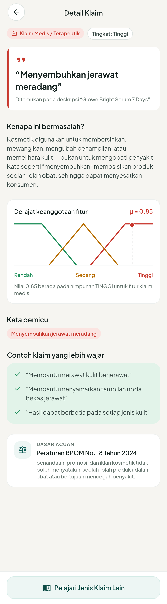 | 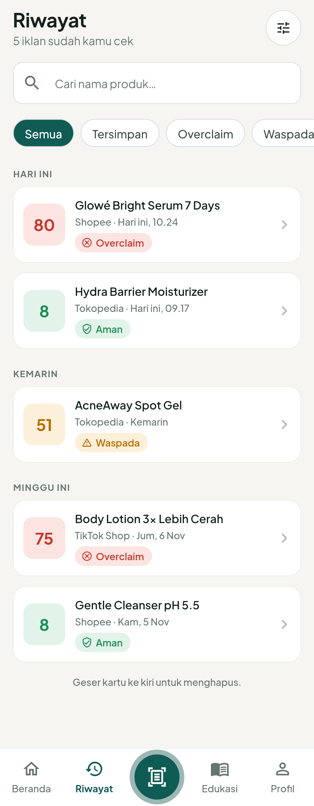 | 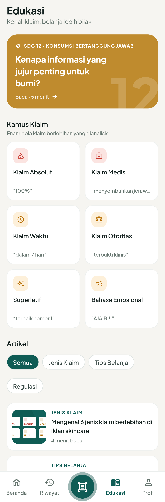 | 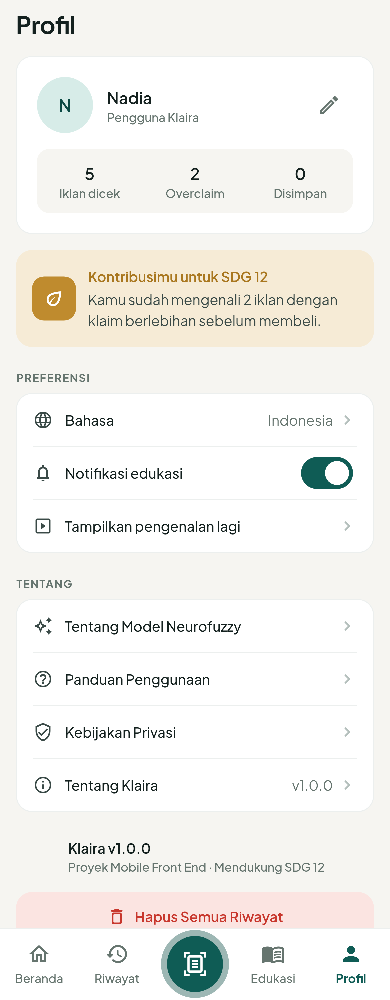 |

| Tablet — NavigationRail | Tablet — Hasil dua kolom | HP lanskap — Onboarding |
|---|---|---|
| 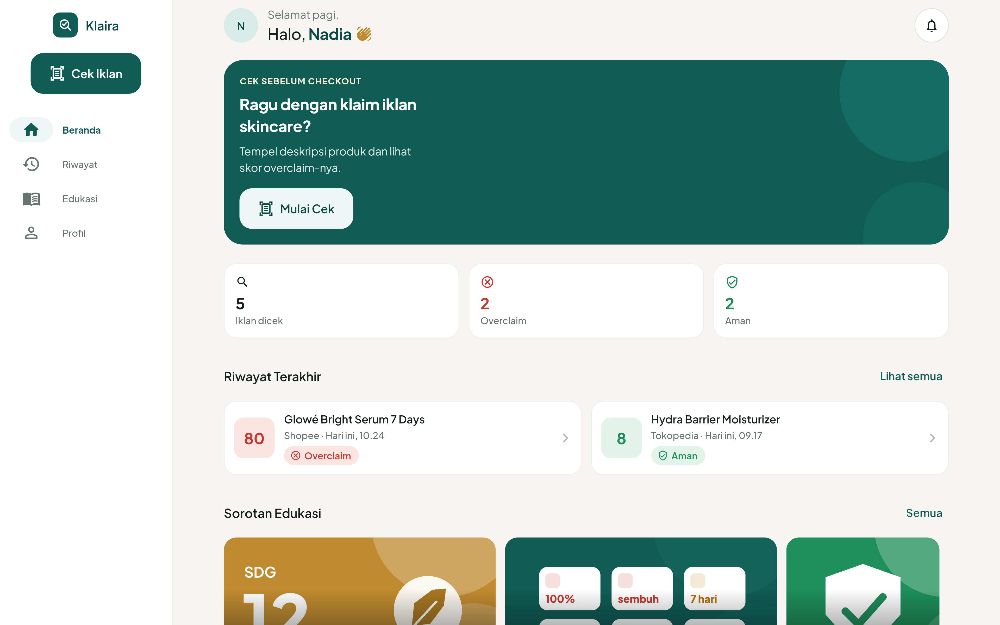 | 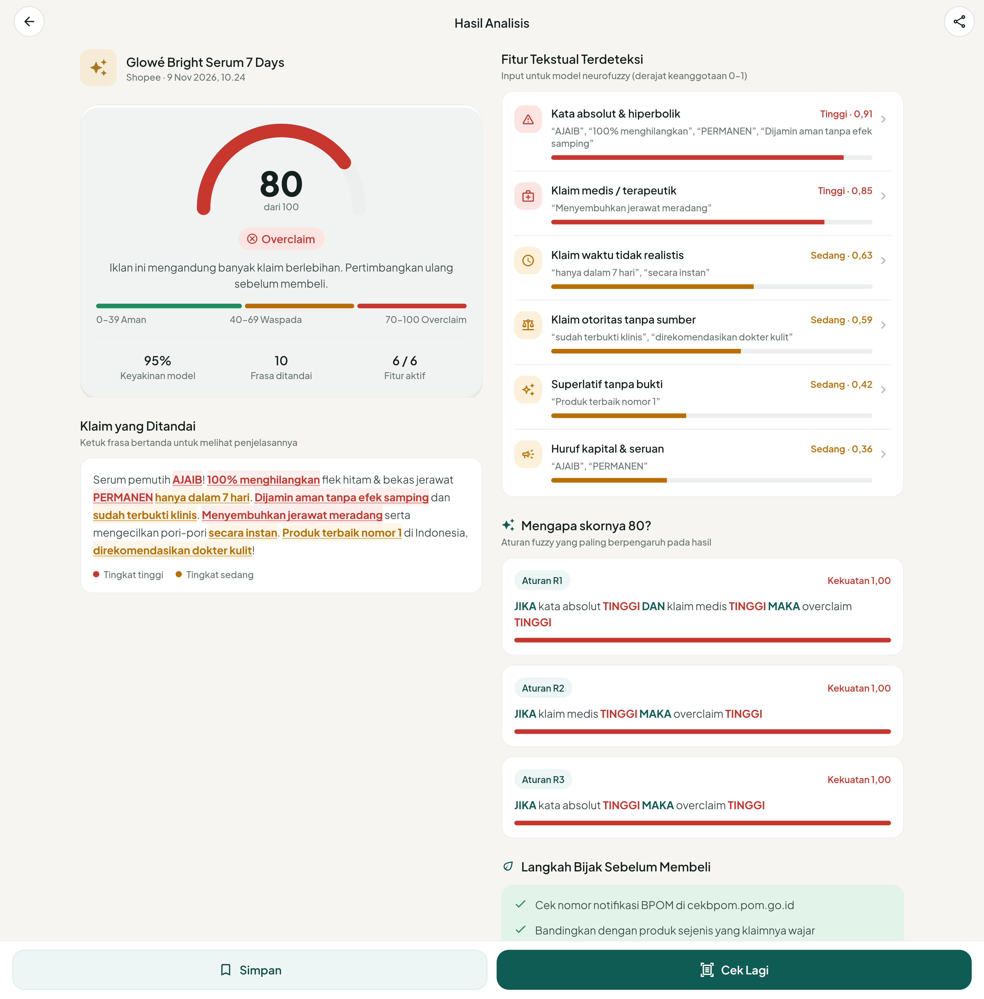 | 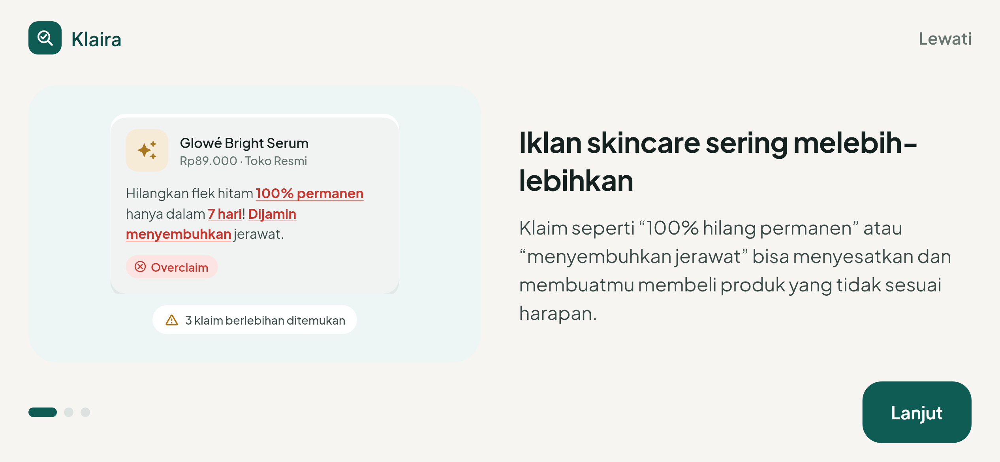 |

Seluruh 14 layar (ditambah 5 tangkapan tablet/lanskap) ada di [`test/golden/goldens/`](test/golden/goldens/). Desain sumbernya ada di [Figma](https://www.figma.com/design/lNKPtH5PgVloENyvqL9GX9/Aplikasi-Deteksi-Dini-Overclaim-pada-Iklan-Skincare-untuk-Mendukung-Konsumsi-yang-Bertanggung-Jawab).

---

## 🚀 Cara paling cepat: pasang APK

File **`app-release.apk`** disertakan di luar folder project (di dalam zip). Salin ke HP Android → buka → izinkan *Install unknown apps* → pasang. Cocok untuk demo ke dosen tanpa laptop.

---

## 🛠️ Menjalankan dari kode sumber

### 1. Prasyarat

| Kebutuhan | Versi |
|---|---|
| Flutter SDK | **3.27 atau lebih baru** (diuji pada 3.47.8 stable) |
| Dart | ikut Flutter (≥ 3.6) |
| Android Studio / Android SDK | untuk emulator atau HP Android |
| JDK | 17 atau lebih baru (biasanya sudah ikut Android Studio) |
| Editor | VS Code (ekstensi *Flutter*) atau Android Studio |

Cek instalasi dengan `flutter doctor` — semua baris Android harus centang hijau.

### 2. Jalankan

```bash
cd klaira
flutter pub get
flutter run
```

Pilih perangkat (emulator / HP via USB dengan *USB debugging* aktif). Di VS Code cukup tekan **F5** — konfigurasi sudah tersedia di `.vscode/launch.json`.

### 3. Perintah penting

| Tujuan | Perintah |
|---|---|
| Menjalankan aplikasi | `flutter run` |
| Cek kualitas kode (lint) | `flutter analyze` |
| Menjalankan semua test | `flutter test` |
| Memperbarui tangkapan layar | `flutter test --tags golden --run-skipped --update-goldens` |
| Build APK untuk dibagikan | `flutter build apk --release` → `build/app/outputs/flutter-apk/app-release.apk` |
| Build APK lebih kecil per arsitektur | `flutter build apk --release --split-per-abi` |

---

## ✨ Fitur

- **Splash & onboarding** 3 slide (overclaim, cara kerja model, SDG 12).
- **Cek iklan** dengan dua cara: *Tempel Teks* (ada tombol **Gunakan contoh** untuk demo) atau *Tempel Link* Shopee / Tokopedia / TikTok Shop (pengambilan deskripsi disimulasikan).
- **Menganalisis** — animasi tahapan *pipeline* (pra-pemrosesan → ekstraksi fitur → inferensi neurofuzzy → penjelasan).
- **Hasil analisis yang dapat dijelaskan**: skor 0–100 (gauge), kategori Aman / Waspada / Overclaim, frasa bermasalah ditandai langsung di teks (bisa diketuk), 6 fitur tekstual dengan derajat keanggotaan, dan 3 aturan fuzzy “JIKA–MAKA” paling berpengaruh.
- **Detail klaim**: alasan, grafik fungsi keanggotaan RENDAH–SEDANG–TINGGI, kata pemicu, contoh klaim yang wajar, dan dasar acuan Peraturan BPOM.
- **Riwayat**: pencarian, filter (Semua/Tersimpan/Overclaim/Waspada/Aman), dikelompokkan per tanggal, geser untuk hapus + *Urungkan*.
- **Edukasi**: konten SDG 12, kamus 6 jenis klaim, dan 4 artikel.
- **Profil**: statistik, kontribusi SDG 12, ubah nama, notifikasi edukasi, tampilkan onboarding lagi, info model/privasi/panduan, hapus riwayat.
- **Responsif & adaptif** (Material 3 *window size class*): HP potret memakai *bottom navigation*; layar ≥ 600 dp (HP lanskap, tablet) beralih ke `NavigationRail`; Hasil Analisis menjadi dua kolom pada layar ≥ 840 dp; Onboarding menyusun ilustrasi & teks berdampingan saat lanskap; grid Kamus Klaim/Artikel menyesuaikan jumlah kolom. Lihat `lib/core/utils/responsive.dart`.
- **Sorotan Edukasi** berupa `CarouselView` (Material 3) dengan gambar sampul artikel (`Image.asset`).
- Data **tersimpan di perangkat** (SharedPreferences) — riwayat tetap ada setelah aplikasi ditutup.

---

## 🗂️ Struktur folder

```
lib/
├── main.dart                     # Titik masuk aplikasi
├── bootstrap.dart                # Menyiapkan repository & state (titik integrasi model)
├── app.dart                      # MaterialApp.router + Provider
├── core/
│   ├── theme/                    # Design system dari Figma → kode
│   │   ├── app_colors.dart       #   token warna (color/*)
│   │   ├── app_spacing.dart      #   token jarak & radius (space/*, radius/*)
│   │   ├── app_typography.dart   #   skala teks Plus Jakarta Sans
│   │   └── app_theme.dart        #   ThemeData Material 3
│   ├── router/app_router.dart    # Semua rute (go_router)
│   ├── constants/app_info.dart   # Nama app, versi, anggota tim
│   └── utils/formatters.dart     # Format tanggal/angka Bahasa Indonesia
├── data/
│   ├── models/                   # Model data = kontrak JSON dengan model ML
│   ├── repositories/             # Sumber data (konten JSON & analisis)
│   └── simulation/               # Simulator neurofuzzy untuk prototipe
├── state/app_state.dart          # State global (riwayat, onboarding, preferensi)
├── shared/widgets/               # Komponen dipakai ulang (StatusBadge, AppCard, …)
└── features/                     # Satu folder per kelompok layar
    ├── splash/  onboarding/  shell/  home/
    ├── check/        # Cek Iklan + Menganalisis
    ├── result/       # Hasil Analisis + Detail Klaim (+ widgets/)
    ├── history/  education/  profile/
assets/
├── data/                         # ✏️ DATA DUMMY — edit tanpa menyentuh kode
│   ├── sample_ads.json           #   contoh iklan (dipakai riwayat awal & tombol contoh)
│   ├── articles.json             #   artikel edukasi
│   ├── claim_insights.json       #   kamus 6 jenis klaim & penjelasannya
│   └── tips.json                 #   tips "Tahukah kamu?"
├── fonts/                        # Plus Jakarta Sans (lisensi OFL)
└── images/                       # logo.png + articles/ (sampul artikel)
test/
├── unit/                         # Test simulator & kontrak JSON
├── widget/                       # Test alur Beranda → Hasil & test responsif
└── golden/                       # Tangkapan layar 14 layar + tablet/lanskap
docs/                             # Arsitektur, kontrak data, integrasi model, vibe coding
```

Penjelasan lengkap arsitektur dan pemetaan komponen Figma → widget ada di [`docs/ARSITEKTUR.md`](docs/ARSITEKTUR.md).

---

## ✏️ Mengubah data dummy

| Ingin mengubah… | Edit file |
|---|---|
| Contoh iklan / isi riwayat awal | `assets/data/sample_ads.json` |
| Artikel edukasi | `assets/data/articles.json` |
| Penjelasan jenis klaim | `assets/data/claim_insights.json` |
| Tips di Beranda | `assets/data/tips.json` |
| Kata pemicu overclaim (simulator) | `lib/data/simulation/overclaim_lexicon.dart` |
| Nama default pengguna | `AppState.defaultName` di `lib/state/app_state.dart` |

> Riwayat awal hanya dibuat **sekali** saat aplikasi pertama dibuka. Setelah mengubah `sample_ads.json`, hapus data aplikasi (Pengaturan HP → Aplikasi → Klaira → Hapus data) atau *uninstall* lalu jalankan ulang.

---

## 🧠 Tentang simulator analisis

`OverclaimSimulator` meniru alur model pada proposal (Gambar 3.2) agar teks apa pun menghasilkan hasil yang masuk akal:

1. **Ekstraksi fitur** — mencocokkan leksikon 6 kategori klaim; derajat keanggotaan μ = 1 − e^(−k·n).
2. **Fuzzifikasi** — himpunan RENDAH / SEDANG / TINGGI (fungsi segitiga/trapesium).
3. **Inferensi** — 10 aturan JIKA–MAKA, operator DAN = minimum.
4. **Defuzzifikasi** — rata-rata terbobot Sugeno orde nol → skor 0–100.

Simulator ini **bukan model final**; ia hanya memastikan antarmuka bisa didemokan secara realistis. Untuk menyambungkan model ANFIS asli, ikuti [`docs/PANDUAN_INTEGRASI_MODEL.md`](docs/PANDUAN_INTEGRASI_MODEL.md) — cukup membuat satu kelas repository baru dan mengganti satu baris di `bootstrap.dart`. Struktur JSON-nya dijelaskan di [`docs/KONTRAK_DATA.md`](docs/KONTRAK_DATA.md).

---

## 👥 Pembagian kerja per folder

Sesuai Log Book tim (rincian per sub-proyek ada di file Log Book):

| Anggota | Fokus folder |
|---|---|
| Arza | `core/theme/`, `features/result/`, `data/simulation/`, `core/utils/responsive.dart`, `features/shell/` |
| Vincent | `main.dart`, `app.dart`, `features/splash/`, `features/onboarding/`, `features/check/`, `core/router/`, `features/analyzing/` |
| Figo | `shared/widgets/`, `features/home/`, `features/history/`, `data/repositories/` |
| Jason | `analysis_options.yaml`, `features/education/`, `features/profile/`, `test/`, `docs/` |

Gunakan Git dengan satu *branch* per fitur (`feature/riwayat-filter`, dst.) dan jalankan `flutter analyze && flutter test` sebelum *merge*.

---

## 🧯 Troubleshooting

| Masalah | Solusi |
|---|---|
| `flutter pub get` gagal karena versi SDK | Perbarui Flutter: `flutter upgrade`. Minimal Flutter 3.27. |
| Error “version solving failed” | Hapus `pubspec.lock` (jika ada) lalu `flutter pub get` lagi. |
| Build Android lama di awal | Normal — Gradle mengunduh dependensi sekali (5–10 menit). |
| `Unsupported class file major version` / masalah Java | Pakai JDK 17+: `flutter config --jdk-dir <path-jdk>`. |
| Perangkat tidak terdeteksi | Aktifkan *USB debugging*, jalankan `flutter devices`, atau buat emulator di Android Studio → Device Manager. |
| Ingin melihat onboarding lagi | Profil → **Tampilkan pengenalan lagi**. |
| Riwayat ingin dikosongkan | Profil → **Hapus Semua Riwayat**. |
| Golden test berbeda di laptop lain | Wajar (render font beda OS). Golden test dilewati saat `flutter test` biasa. |

---

## 📄 Lisensi & kredit

- Font **Plus Jakarta Sans** oleh Tokotype — [SIL Open Font License 1.1](assets/fonts/OFL.txt).
- Ikon: Material Icons (Apache 2.0).
- Acuan regulasi pada konten edukasi: Peraturan BPOM No. 3 Tahun 2022 dan No. 18 Tahun 2024.
- Hasil analisis pada aplikasi adalah indikasi awal berbasis teks, **bukan** keputusan resmi BPOM maupun saran medis.
